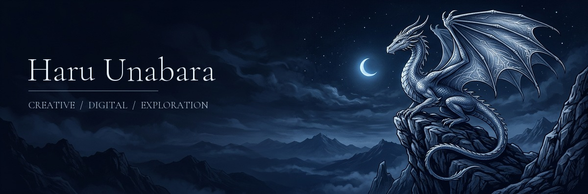

  

# Haru Unabara

**Creative Developer | Digital Artist | Technology Explorer**

  

<strong>CREATIVE | SPECIALIST | BREATHING</strong>

I’m Haru Unabara. I bring software development, digital art, and illustration into the same workspace. I’m interested in thoughtful application design, creative problem-solving, and exploring AI and emerging technology through experimental and practical projects.

From a drawing canvas to a new development tool, I like turning an idea into something I can use, question, and refine.

Read the hero without animation

Creative and Illustrative → Breathe and Relax → Play the Game

The artwork is static; only the phrase strip animates. Each phrase has a five-second interval, including a gentle crossfade. Open the [static artwork](assets/hero.jpg) without the animated strip if you prefer.

---

## The workshop

A mix of creative tools, practical applications, and experiments. Statuses describe work in progress—not release promises.

| Project | Direction | Status |
| :--- | :--- | :--- |
| [**OASIS-AI**](https://github.com/ejhay27/Oasis-Ai) | An evolving AI video-studio project. | In Development |
| **O.R.V.Y.N** | An AI-assistant project. | Prototype |
| **Purge** | A security and PC-focused project. | In Development |
| **IDE** | An integrated development environment project. | In Development |
| **BASALT** | A database-oriented project. | Prototype |
| **Carbon: Flux** | A separate animation application project. | Prototype |
| [**Carbon**](https://github.com/ejhay27/carbon-digital-drawing-studio) | A digital drawing application; the repository identifies the studio as Carbon: Prime. | Working Build |
| **Folian** | A presentation-making project. | Prototype |
| **Xenon Pro DAW** | A digital audio workstation project. | In Development |
| **MyClassmate** | A student-oriented application. | Prototype |

Project link review

Public repository destinations were verified for OASIS-AI and Carbon. Links for O.R.V.Y.N, Purge, IDE, BASALT, Carbon: Flux, Folian, Xenon Pro DAW, and MyClassmate remain **pending review**. Their descriptions and statuses follow the owner-supplied inventory, not independently verified implementation features. Carbon and Carbon: Flux are distinct projects.

---

## Tools at the workbench

Technologies present in my public project source—not a claim of mastery.

   &nbsp;
   &nbsp;
   &nbsp;
   &nbsp;
  

**TypeScript · React · Vite · Tailwind CSS · Electron**

Verified in [Carbon’s source manifest](https://github.com/ejhay27/carbon-digital-drawing-studio/blob/main/package.json). Carbon also documents Canvas 2D, three.js, Zustand, and Capacitor in its [project guide](https://github.com/ejhay27/carbon-digital-drawing-studio#readme).

## Public code, in perspective

A **2026-10-15 snapshot** of GitHub’s language-byte data across the five public repositories on `ejhay27`. This measures repository code volume, not proficiency or contribution activity. Rounded percentages may not total 100%. No rankings, private data, or third-party statistics service.

[Live repositories and languages](https://github.com/ejhay27?tab=repositories) · [Contribution activity](https://github.com/ejhay27?tab=overview) · [Snapshot and methodology](docs/languages.json)

---

## Find me

[**GitHub · @ejhay27**](https://github.com/ejhay27) · [**Portfolio source**](https://github.com/ejhay27/Portfolio)

Haru Unabara · CREATIVE | SPECIALIST | BREATHING
