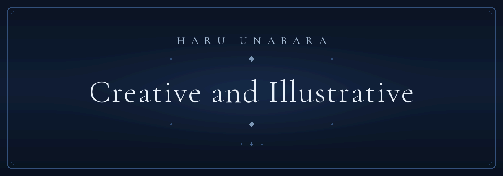
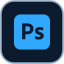
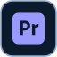
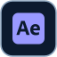
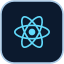
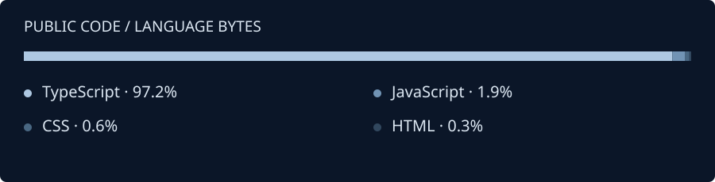

  

<h1 align="center">Haru Unabara</h1>

<strong>CREATIVE | SPECIALIST | BREATHING</strong>

Read the hero without animation

Creative and Illustrative → Breathe and Relax → Play the Game

The card above is an autoplaying GIF: each phrase holds for about 4.5 seconds, dissolves over about half a second, and the cycle loops endlessly with no buttons, clicks, or scripts. If you prefer stillness, the three phrases are written out here — nothing else on this page moves.

## About

I'm Haru Unabara — a creative developer drawn to both programming and digital creativity. I build original applications: drawing studios, small tools, ambitious prototypes — and I care about how software looks and feels as much as how it works.

Code and illustration share the same desk here. My biggest build so far is Carbon, a digital drawing studio that runs fully offline; that local-first, no-accounts feeling is what I like building toward. Everything else on this page is work in progress — prototypes I'm shaping, testing, and refining in the open.

## The Workshop

Ten projects, one bench. Statuses describe where each one actually stands — work in progress, not release promises.

| Project | Direction | Status |
| :--- | :--- | :--- |
| [**OASIS-AI**](https://github.com/ejhay27/Oasis-Ai) | A local-first AI video studio concept. | In Development |
| **O.R.V.Y.N** | A customizable AI assistant. | Prototype |
| **Purge** | A security and PC-focused software concept. | In Development |
| **IDE** | An integrated development environment project. | In Development |
| **BASALT** | A database-oriented project concept. | Prototype |
| **Carbon: Flux** | A separate animation application. | Prototype |
| [**Carbon**](https://github.com/ejhay27/carbon-digital-drawing-studio) | A digital drawing application. The repository publishes the studio as Carbon: Prime. | Working Build |
| **Folian** | A presentation maker. | Prototype |
| **Xenon Pro DAW** | A digital audio workstation project. | In Development |
| **MyClassmate** | A student-oriented application. | Prototype |

Project link review

Only OASIS-AI and Carbon have public repositories today, and both destinations were verified against the live account. O.R.V.Y.N, Purge, IDE, BASALT, Carbon: Flux, Folian, Xenon Pro DAW, and MyClassmate are deliberately listed without links until public destinations exist for them — no guessed URLs. Descriptions and statuses follow the owner-supplied inventory. Carbon and Carbon: Flux are separate projects and stay on separate rows.

─────&nbsp;&nbsp;✦&nbsp;&nbsp;─────

## Creative & Design Tools

The illustration, motion, and modeling side of the desk.

<table>
  <tr>
    <td align="center" valign="middle" width="25%"> <b>Adobe Photoshop</b></td>
    <td align="center" valign="middle" width="25%"> <b>Adobe Illustrator</b></td>
    <td align="center" valign="middle" width="25%"> <b>Adobe Premiere Pro</b></td>
    <td align="center" valign="middle" width="25%"> <b>Adobe After Effects</b></td>
  </tr>
  <tr>
    <td align="center" valign="middle"> <b>Figma</b></td>
    <td align="center" valign="middle"> <b>Krita</b></td>
    <td align="center" valign="middle"> <b>Blender</b></td>
    <td align="center" valign="middle"> <b>Alight Motion</b></td>
  </tr>
</table>

Alight Motion has no official glyph in open icon sets, so its tile is a plain "AM" lettermark — a typographic placeholder, not an imitation of the brand icon.

## Development Tools & Environment

Where the code lives: editors, version control, runtime, and packaging.

<table>
  <tr>
    <td align="center" valign="middle" width="25%"> <b>Visual Studio Code</b></td>
    <td align="center" valign="middle" width="25%"> <b>IntelliJ IDEA</b></td>
    <td align="center" valign="middle" width="25%"> <b>Git</b></td>
    <td align="center" valign="middle" width="25%"> <b>GitHub</b></td>
  </tr>
  <tr>
    <td align="center" valign="middle"> <b>Node.js</b></td>
    <td align="center" valign="middle"> <b>npm</b></td>
    <td align="center" valign="middle"> <b>Vite</b></td>
    <td align="center" valign="middle"> <b>Electron</b></td>
  </tr>
</table>

## Programming Languages & Technologies

**Currently using — languages**, evidenced by public project source and repository language data:

<table>
  <tr>
    <td align="center" valign="middle" width="25%"> <b>TypeScript</b></td>
    <td align="center" valign="middle" width="25%"> <b>JavaScript</b></td>
    <td align="center" valign="middle" width="25%"> <b>HTML5</b></td>
    <td align="center" valign="middle" width="25%"> <b>CSS3</b></td>
  </tr>
</table>

**Currently using — frameworks & related**, verified in project manifests:

<table>
  <tr>
    <td align="center" valign="middle" width="25%"> <b>React</b></td>
    <td align="center" valign="middle" width="25%"> <b>Tailwind CSS</b></td>
    <td align="center" valign="middle" width="25%"> <b>Vite</b></td>
    <td align="center" valign="middle" width="25%"> <b>Electron</b></td>
  </tr>
</table>

TypeScript, React, Vite, Tailwind CSS, and Electron are confirmed in [Carbon's dependency manifest](https://github.com/ejhay27/carbon-digital-drawing-studio/blob/main/package.json); Carbon's source additionally documents Canvas 2D, three.js, Zustand, and Capacitor. JavaScript, CSS, and HTML appear across the public repositories (see the snapshot below).

**Learning / Exploring** — nothing is listed under these headings yet. This section only shows what public code can back, so there are no aspirational logos, proficiency bars, years, or rankings here. Database engines and database administration tools are deliberately absent from this personal toolkit as well; a project concept such as BASALT does not imply a personal stack claim. When a language earns a row here, a project will have put it there.

─────&nbsp;&nbsp;✦&nbsp;&nbsp;─────

## Public Code, In Perspective

A **2026-10-15** snapshot of GitHub's language-byte data across the five public repositories on `ejhay27`, this profile repository included — the Python share is the maintenance scripts under `scripts/`. It measures repository code volume, not proficiency or contribution activity. Rounded percentages may not total 100%.

[Live repositories](https://github.com/ejhay27?tab=repositories) · [Contribution activity](https://github.com/ejhay27?tab=overview) · [Snapshot data & method](docs/languages.json)

No third-party statistics card services are embedded: nothing here can expire silently or dress an outside estimate as official GitHub data. Contribution-streak widgets are omitted because no dependable README-compatible source exists for them.

─────&nbsp;&nbsp;✦&nbsp;&nbsp;─────

## Find Me

&nbsp; [**GitHub — @ejhay27**](https://github.com/ejhay27) &nbsp;·&nbsp; [**Portfolio source**](https://github.com/ejhay27/Portfolio)

The account lists no public email, website, or other social profiles, so none are invented here.

Haru Unabara · CREATIVE | SPECIALIST | BREATHING

